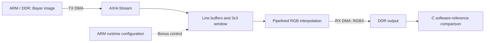

# Digital VLSI Labs

**From VHDL building blocks to a Zynq image-processing system**
Digital VLSI coursework · National Technical University of Athens · 2026

A collection of collaboratively developed laboratory work covering combinational and sequential circuits, pipelined arithmetic, FIR filtering and hardware/software integration on Zybo. The later exercises build a streaming Bayer-to-RGB converter and connect it to ARM software using AXI and DMA.

This repository was organized after the coursework from saved Vivado/Vitis projects and reports. Its initial Git history records publication of that archive, rather than the original development timeline.

## Featured: runtime-configurable Debayer

**[Explore the bonus project →](bonus/README.md)**

The bonus extends the image-processing pipeline with ARM-controlled image dimensions, separating the configuration path from DMA pixel transfers. It combines VHDL line buffers and interpolation, AXI GPIO configuration, Vivado Tcl integration and a Vitis C application with cache maintenance and software-reference comparison.

The later software has dedicated inputs for **64×64, 128×128, 256×256, 512×512 and 1024×1024**. These are supported input selections in that source; the archived notes do not establish a verified board run for every size.

[Runtime VHDL](bonus/runtime-hardware/vhdl_srcs/) · [Vivado build flow](bonus/runtime-hardware/scripts/build_bonus_runtime.tcl) · [Vitis application](bonus/runtime-software/main_bonus_runtime_separate_inputs.c)

## Explore the laboratories

| Laboratory | What was built | Techniques |
| :--- | :--- | :--- |
| [01 · Digital building blocks](lab-01/README.md) | Decoders, registers, counters and structural binary/BCD adders | Behavioral/dataflow/structural VHDL, testbenches |
| [02 · Clocked arithmetic](lab-02/README.md) | Synchronous and pipelined adders; a systolic multiplier | Register alignment, pipeline latency, arithmetic cells |
| [03 · FIR architecture](lab-03/README.md) | Coefficient ROM, sample RAM, MAC, controller and complete FIR | Memory organization, sequencing, fixed-width arithmetic |
| [04 · AXI-Lite FIR](lab-04/README.md) | Memory-mapped FIR interface and ARM-side register access | Custom IP wrapper, register mapping, Vivado/Vitis |
| [05 · Streaming Debayer](lab-05/README.md) | Development stages from a 3×3 neighborhood to a pipelined image stream | Bayer pattern, line buffers, boundary padding |
| [06 · Zynq integration](lab-06/README.md) | Debayer accelerator connected to DDR through DMA | AXI4-Stream, PS/PL integration, C reference comparison |
| [Bonus · Runtime configuration](bonus/README.md) | Change image dimensions from ARM software | AXI GPIO control, DMA, cache maintenance |

## How the image pipeline works

The image-processing core accepts an 8-bit GBRG Bayer stream. Two line buffers and shift registers form a 3×3 neighborhood; the missing color components are calculated from neighboring samples using additions and shifts. Boundary pixels use zero padding.

The fixed-size integration and the bonus runtime design are separate source configurations. The repository preserves their different interfaces rather than treating every saved version as interchangeable.

## Verification you can inspect

**Fresh simulation check — 18 November 2026:** Vivado Simulator 2022.2 ran the saved Lab 6 testbench on a deterministic 4×4 image. All **16 RGB pixels / 48 channel values** matched an independent software calculation. The input, simulator output and a comparison script are included.

[View the actual result →](evidence/debayer-4x4/README.md) · [Repeat the comparison →](tests/README.md)

The 22 VHDL units recovered from reports also passed VHDL-2008 analysis in Vivado 2022.2. Analysis is a syntax/semantic check, not a claim that every testbench or hardware system has been run again.

The saved course report describes a 1024×1024 Zynq run and resource measurements. Those historical statements are identified separately from the fresh small simulation. Estimated console text and generated reference values are not presented as board captures.

## Repository guide

- `rtl/` and `sim/` contain design and testbench source within each lab.
- `software/` contains ARM-side code that requires the matching Vitis BSP.
- `integration/` contains saved PS/PL wrappers and Vivado Tcl flows.
- `reference/` and `reference-platform/` identify supplied examples and infrastructure.
- Alternative FIR, Debayer and bonus snapshots remain in separate folders.

[Build and dependency notes](docs/BUILD.md) · [Source provenance](docs/SOURCES.md) · [Verification scope](docs/VERIFICATION.md)

## Academic context

Developed collaboratively as NTUA coursework. This portfolio copy was prepared from the archive of **Theodoros Rimagmos**. Supplied framework code and generated wrappers retain their existing attribution. The English explanations summarize the implementations in original wording; course handouts and complete vendor BSPs are not redistributed.
